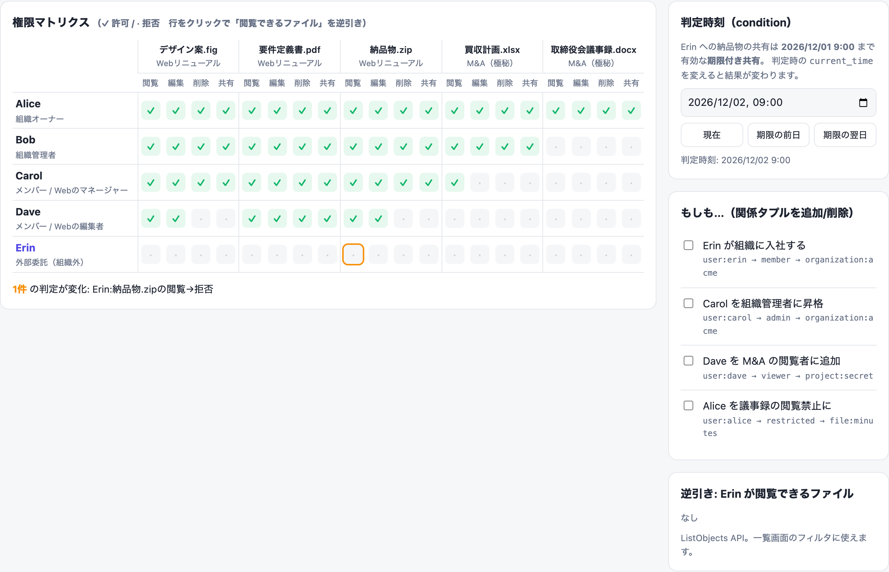

# OpenFGA 権限マトリクス PoC

組織・メンバー・プロジェクト・ファイルの関係から「誰が何をできるか」を
**5人 × 5ファイル × 4操作 = 100パターン** まとめて判定するデモです。


「もしも」でタプルを1件追加すると、影響する判定がハイライトされます（例: Carol を組織管理者に昇格 → 7件が許可に変化）。
右下は ListObjects による逆引き結果です。


「判定時刻」を期限の翌日にすると、condition（期限付き共有）が満たされなくなり、Erin の閲覧だけが拒否に変わります。



## 起動

```bash
npm install
npm run fga:up      # OpenFGA (in-memory) を Docker で起動 :8080
npm run dev         # UI: http://localhost:3000
npm run fga:down    # 停止（データはメモリ上なので消える）
```

## テスト

```bash
npm test            # OpenFGA 起動中に実行。期待する権限表(=仕様)と照合
npm run typecheck
```

## 構成

| ファイル | 役割 |
|---|---|
| `src/model.fga` | 認可モデル（権限ロジックのすべて） |
| `src/scenario.ts` | メンバー・ファイル・初期タプル・What-if・期限付き共有の定義 |
| `src/authz.ts` | ストア作成 / BatchCheck / ListObjects |
| `src/server.ts` | API + 静的配信 |
| `public/index.html` | マトリクス UI |
| `test/authz.test.ts` | 100 パターンの期待値（仕様）テスト、condition のテスト |

### API

| メソッド | パス | 説明 |
|---|---|---|
| GET | `/api/meta` | ユーザー・ファイル・モデル・タプルなどの定義 |
| GET | `/api/check?at=<ISO8601>` | 100 パターンを BatchCheck（`at` 省略時は現在時刻） |
| POST | `/api/what-if` | `{ id, enabled, at? }` でタプルを追加/削除して再判定 |
| GET | `/api/list-objects?user=<id>&at=<ISO8601>` | そのユーザーが閲覧できるファイル一覧 |

## シナリオ

| メンバー | 立場 | ポイント |
|---|---|---|
| Alice | 組織オーナー | owner → admin → member と包含され、全権限 |
| Bob | 組織管理者 | 全プロジェクトの manager。ただし議事録は閲覧禁止（`but not`） |
| Carol | メンバー / Web マネージャー | 買収計画だけ個別共有されている |
| Dave | メンバー / Web 編集者 | 要件定義書のオーナー |
| Erin | 外部委託（組織外） | 納品物だけ **30 日間の期限付き**で共有（condition） |

## デモで見せられる OpenFGA の価値

- **継承**: 組織 owner ⊂ admin ⊂ member、組織 admin → 全プロジェクト manager → ファイル編集…
- **グループ共有**: `organization:acme#member` を viewer にするだけで全社公開
- **例外 (`but not`)**: 組織管理者 Bob でも議事録は閲覧禁止
- **条件 (condition)**: 期限付き共有。判定時刻を変えるだけで結果が変わる
- **What-if**: タプル1件の追加/削除で、関係する判定がまとめて変わる（コード変更なし）
- **逆引き (ListObjects)**: 「このユーザーが見られるファイル一覧」

---

## OpenFGA とは

OpenFGA は、Google の認可基盤 Zanzibar の論文をもとにした認可エンジンです。
ロール管理（RBAC）もできますが、中心にあるのは **関係ベースの認可（ReBAC）** です。

- RBAC: 「Bob は admin」とロールを付けて終わり
- ReBAC: 「誰が・どのリソースと・どんな関係か」をたどって権限を導く

```
Carol が組織の admin になる
  → 組織の admin は全プロジェクトの manager（admin from organization）
  → manager はファイルを削除できる（manager from project）
```

### 定義するのは 2 つだけ

1. **認可モデル（スキーマ）** … `src/model.fga`。ルール。めったに変えない
   - `type` でリソースの種類、`define` で関係と権限を定義
2. **関係タプル（データ）** … `user · relation · object` の 3 つ組。事実。日々追加・削除する
   - 例: `user:dave · owner · file:spec`

アプリは「Dave は spec を削除できる？」と聞くだけで、答えはモデル × タプルから OpenFGA が導きます。

### モデルで表現できること

| 書き方 | 意味 | この PoC での例 |
|---|---|---|
| `[user]` | 直接付与 | Dave は spec のオーナー |
| `or` | どれかを満たせばよい（継承・包含） | `admin: [user] or owner` |
| `and` | すべてを満たす | ― |
| `but not` | 例外として除外 | Bob は議事録を閲覧禁止 |
| `X from Y` | 親リソースの関係をたどる | プロジェクト → ファイルへの継承 |
| `organization#member` | グループごと付与 | Web プロジェクトを全社公開 |
| `user:*` | 全員に付与（公開リンクなど） | ― |
| `user with <condition>` | 条件付きで付与（ABAC 的） | Erin への期限付き共有 |

### condition（条件付きの関係）

関係タプルに「条件」を付け、判定時に渡した値で有効/無効を決めます。条件は CEL という式言語で書きます。

```
type file
  relations
    define viewer: [user, user with non_expired_grant] or editor or viewer from project

condition non_expired_grant(current_time: timestamp, grant_time: timestamp, grant_duration: duration) {
  current_time < grant_time + grant_duration
}
```

パラメータの渡し方は 2 通りあります。

| 渡す場所 | この PoC での値 | タイミング |
|---|---|---|
| タプル側 | `grant_time`, `grant_duration` | タプルを書くとき（共有した日時・期間） |
| 判定リクエスト側 | `current_time` | Check / ListObjects のたび（`context`） |

```ts
// タプルを書くとき
{ user: "user:erin", relation: "viewer", object: "file:handover",
  condition: { name: "non_expired_grant", context: { grant_time: "...", grant_duration: "720h" } } }

// 判定するとき
client.batchCheck({ checks: [{ user, relation, object, context: { current_time: new Date().toISOString() } }] })
```

ポイント:

- 期限が来てもタプルを消すバッチ処理は不要。判定時刻だけで自動的に無効になる
- 条件は **経路ごと** に評価される。期限切れ後でも、Erin が組織に入社すれば全社公開の経路で閲覧できる
- ほかの使い道: 社内 IP からのみ許可（`ipaddress` 型 + `in_cidr`）、営業時間内のみ、属性値の一致など
- この PoC では「起動日の 14 日前から 30 日間」を共有期間にしているため、いつ起動しても期限内から始まる

### 問い合わせできること（API）

| API | 何がわかるか | この PoC |
|---|---|---|
| Check / BatchCheck | X は Y を Z できるか | 100 パターン判定 |
| ListObjects | X が閲覧できるファイル一覧 | 逆引きパネル |
| ListUsers | このファイルを閲覧できる人の一覧 | ― |
| Expand | その権限がどの関係から来ているか（木構造） | ― |
| ReadChanges | タプルの変更履歴（監査・キャッシュ破棄） | ― |
| Contextual Tuples | 保存せずにその判定だけ関係を一時追加 | ― |

### アプリとの役割分担

OpenFGA は「聞かれたら答える」判断役（PDP）で、リクエストに割り込んで勝手に弾くことはしません。
実際に止めるのはアプリ側（PEP）です。

```
ログイン（認証基盤: Auth0 / Cognito など） → JWT の sub = user:xxx
        ↓
アプリの共通入口（ミドルウェア等）で check(user:xxx, can_delete, file:123)
        ↓
false なら 403 / 一覧は ListObjects の結果で絞り込み / ボタンの表示制御にも利用
```

- 権限の **判断ロジック** はモデルに書くので、アプリに if 文の権限ロジックは不要
- 止める場所はミドルウェアやデコレーターに集約するのが定石
  （例: ``app.delete("/files/:id", requirePermission("can_delete", (req) => `file:${req.params.id}`), handler)``）
- フロントの表示制御は見た目だけ。必ずサーバー側でも止める
- 業務データの変更に合わせてタプルを書く・消すのはアプリの責任
  （ファイル作成 → `owner` を書く、退職 → `member` を消す）

### 向いていないこと

- **認証**（ログイン・本人確認）は対象外。認証基盤と組み合わせる
- **大量の業務データにもとづく判定**（例: 金額 100 万円以下なら承認可）は condition でも書けるが、毎回値を渡す必要がある。アプリ側やポリシーエンジン（OPA / Cedar）の方が向くこともある
- **データ同期**はアプリの責任。業務 DB とタプルの整合を取る仕組みが必要

組織・チーム・フォルダ・共有のように **関係がつながって決まる権限**（Google Drive や GitHub のような世界観）を、
コードから切り離してデータで管理するのが最も得意な領域です。
