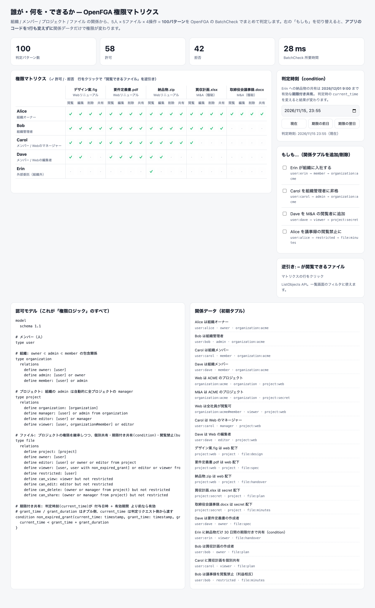
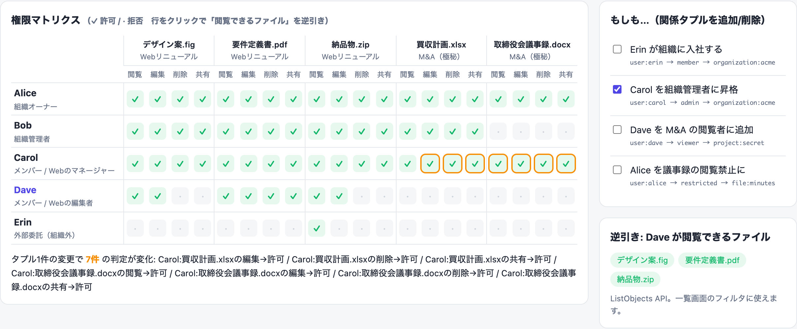

# OpenFGA 権限マトリクス PoC

組織・メンバー・プロジェクト・ファイルの関係から「誰が何をできるか」を
**5人 × 5ファイル × 4操作 = 100パターン** まとめて判定するデモです。



「もしも」でタプルを1件追加すると、影響する判定がハイライトされます（例: Carol を組織管理者に昇格 → 7件が許可に変化）。
右下は ListObjects による逆引き結果です。



## 起動

```bash
npm install
npm run fga:up      # OpenFGA (in-memory) を Docker で起動 :8080
npm run dev         # UI: http://localhost:3000
```

## テスト

```bash
npm test            # OpenFGA 起動中に実行。期待する権限表(=仕様)と照合
npm run typecheck
```

## 構成

| ファイル | 役割 |
|---|---|
| `src/model.fga` | 認可モデル（権限ロジックのすべて） |
| `src/scenario.ts` | メンバー・ファイル・初期タプル・What-if 定義 |
| `src/authz.ts` | ストア作成 / BatchCheck / ListObjects |
| `src/server.ts` | API + 静的配信 |
| `public/index.html` | マトリクス UI |
| `test/authz.test.ts` | 100 パターンの期待値（仕様）テスト |

## デモで見せられる OpenFGA の価値

- **継承**: 組織 owner ⊂ admin ⊂ member、組織 admin → 全プロジェクト manager → ファイル編集…
- **グループ共有**: `organization:acme#member` を viewer にするだけで全社公開
- **例外 (`but not`)**: 組織管理者 Bob でも議事録は閲覧禁止
- **What-if**: タプル1件の追加/削除で、関係する判定がまとめて変わる（コード変更なし）
- **逆引き (ListObjects)**: 「このユーザーが見られるファイル一覧」
